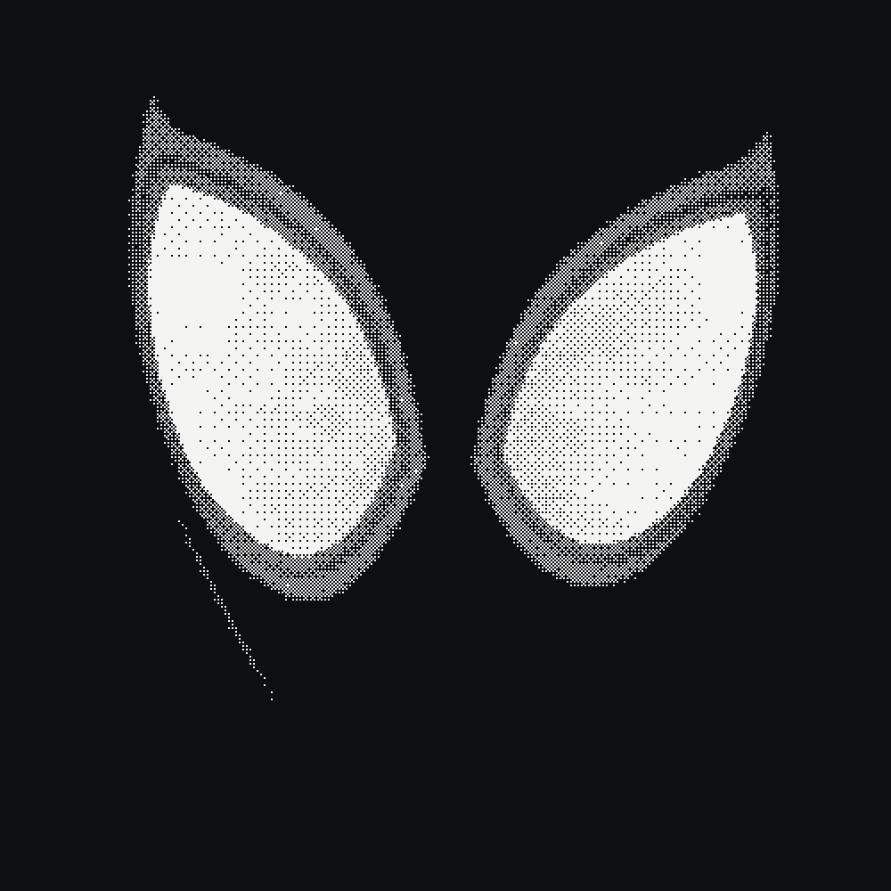

<p align="center"></p>

# Venom Button

A slab of goo that reaches for your cursor. One HTML file, raw WebGL2, no build step.

- **One slab**: the Andrew Hunter mark on a 184px box, centre screen. Drag or throw it.
- **Looks**: Venom, Dither, ASCII (`M`). Dither by default.
- **Themes**: light and dark (`D`). Black and white only.

## Run

```sh
python3 -m http.server 3002   # → http://localhost:3002
```

[Tuning](docs/03-anatomy.md) (`T`) · [How it works](docs/04-how-it-works.md) · [Art](art/)

## Acknowledgments

- [exteestudio/venom-button](https://github.com/exteestudio/venom-button): the original this is forked from.
- [Geist](fonts/Geist-OFL.txt) by Vercel, SIL OFL 1.1.

## License

MIT. See [LICENSE](LICENSE).
